<div align="center">

<a href="https://iamcanturk.dev/en/"></a>

<a href="https://iamcanturk.dev"></a>
<a href="https://x.com/iamcanturk"></a>
<a href="https://www.instagram.com/iamcanturk.dev/"></a>
<a href="https://www.tiktok.com/@iamcanturk.dev"></a>
<a href="https://www.linkedin.com/in/yusufcanturk/"></a>

I'm a full-stack developer focused on application security, working as an<br>
**Application Security Engineer at Kuark** in Bursa, Türkiye.<br>
I build first, then try to break what I built, and I tell the vendor when I find a hole in software I use.<br>
The rest of the time I design the brands and interfaces that sit on top of it all.

<sub><b>TR</b> · Uygulama güvenliğine yoğunlaşmış bir fullstack geliştiriciyim. Önce yazıp sonra kırmayı deniyorum.</sub>

</div>

<br>



<table>
  <tr>
    <td width="33%" valign="top" align="center">
      <br>
      <a href="https://github.com/iamcanturk/DoctorDock"><b>DoctorDock</b></a><br>
      <sub><i>A doctor for your Docker</i></sub>
    </td>
    <td width="33%" valign="top" align="center">
      <br>
      <a href="https://github.com/iamcanturk/erklig"><b>Erklig</b></a><br>
      <sub><i>Mighty backdoor analysis engine</i></sub>
    </td>
    <td width="33%" valign="top" align="center">
      <br>
      <a href="https://github.com/iamcanturk/mergenflow"><b>MergenFlow</b></a><br>
      <sub><i>The freelancer OS</i></sub>
    </td>
  </tr>
  <tr>
    <td valign="top">
      Scans your local Docker environment for security problems, misconfigurations and reclaimable disk in under a second, entirely offline. Ranks findings by severity and gives you a health score out of 100.<br><br>
      <code>Go</code> <code>Docker</code> <code>macOS</code> <code>MIT</code><br>
      <sub><a href="https://doctordock.iamcanturk.dev">doctordock.iamcanturk.dev</a> · <a href="https://iamcanturk.dev/en/proje/doctordock-a-doctor-for-your-docker/">project page</a></sub>
    </td>
    <td valign="top">
      An open-source tool for detecting web shells and backdoors on servers, using signature and behaviour based analysis. Fast triage during penetration tests and incident response.<br><br>
      <code>Go</code> <code>DFIR</code> <code>Pentest</code><br>
      <sub><a href="https://iamcanturk.dev/en/proje/erklig-mighty-backdoor-analysis-engine/">project page</a></sub>
    </td>
    <td valign="top">
      An open-source SaaS for freelancers that combines financial projection, recurring budget management and Kanban workflow tracking in one place. <i>In development.</i><br><br>
      <code>TypeScript</code> <code>SaaS</code><br>
      <sub><a href="https://iamcanturk.dev/en/proje/mergenflow-the-freelancer-os/">project page</a></sub>
    </td>
  </tr>
</table>

<sub>Most of my client and enterprise work is under NDA. These are the ones I can share openly.</sub>

<br>



When I find a vulnerability in software I use, I tell the vendor. Once a fix ships, I publish it.

<table>
  <thead>
    <tr><th align="left">CVE</th><th align="left">Vulnerability</th><th align="left">CVSS</th><th align="left">Affected</th><th align="left">References</th></tr>
  </thead>
  <tbody>
    <tr>
      <td><a href="https://iamcanturk.dev/en/security/cve-2026-28403/"><b>CVE-2026-28403</b></a></td>
      <td>Missing WebSocket origin validation<br><sub>Cross-Site WebSocket Hijacking</sub></td>
      <td></td>
      <td>Textream (macOS) &lt; 1.5.1</td>
      <td><a href="https://iamcanturk.dev/en/security/cve-2026-28403/">Write-up</a> · <a href="https://nvd.nist.gov/vuln/detail/CVE-2026-28403">NVD</a> · <a href="https://github.com/advisories/GHSA-wr3v-x247-337w">GHSA</a></td>
    </tr>
    <tr>
      <td><a href="https://iamcanturk.dev/en/security/cve-2026-28412/"><b>CVE-2026-28412</b></a></td>
      <td>Resource exhaustion through unlimited connections<br><sub>Denial of Service</sub></td>
      <td></td>
      <td>Textream (macOS) &lt; 1.5.1</td>
      <td><a href="https://iamcanturk.dev/en/security/cve-2026-28412/">Write-up</a> · <a href="https://nvd.nist.gov/vuln/detail/CVE-2026-28412">NVD</a> · <a href="https://github.com/advisories/GHSA-qr5p-7x47-qxh9">GHSA</a></td>
    </tr>
  </tbody>
</table>

<br>



<table>
  <tr>
    <td valign="middle" align="center" width="150">
      
    </td>
    <td valign="middle">
      <b>30 seconds a day on software, AI, tech and security.</b><br>
      Short pixel-art videos: vibe-coding pitfalls, password managers, AI agents, famous moments in tech history and a Republic Day special. The videos are in Turkish; every episode's script and checklist live on the site.<br><br>
      &nbsp;
      <a href="https://iamcanturk.dev/en/shorts/"><b>iamcanturk.dev/en/shorts →</b></a><br>
      Watch on <a href="https://www.tiktok.com/@iamcanturk.dev">TikTok</a> · <a href="https://www.instagram.com/iamcanturk.dev/">Instagram</a> · <a href="https://x.com/iamcanturk">X</a><br>
      <sub><b>TR</b> · Her gün 30 saniyede yazılım, yapay zekâ, teknoloji ve güvenlik.</sub>
    </td>
  </tr>
</table>

<br>



Long-form notes on security, software and AI.

- `2026-08-14` &nbsp;**[I Wrote a Doctor for My Docker](https://iamcanturk.dev/en/i-wrote-a-doctor-for-my-docker/)** <sub>· [TR](https://iamcanturk.dev/dockerima-bir-doktor-yazdim/)</sub><br>
  <sub>I used Docker every day but had no idea what was inside it. So I wrote DoctorDock.</sub>
- `2026-08-09` &nbsp;**[Reverse Development in the Age of AI](https://iamcanturk.dev/en/reverse-development-in-the-age-of-ai/)** <sub>· [TR](https://iamcanturk.dev/ai-caginda-tersine-gelisim/)</sub><br>
  <sub>I sat down to write after a long break and noticed I can't think as well as I used to. What is AI doing to the way we think?</sub>

<sub>Subscribe via [RSS](https://iamcanturk.dev/en/rss.xml).</sub>

<br>



```text
software   PHP · Laravel · TypeScript · Go · MySQL
security   OWASP Top 10 · SANS 25 · Pentest · Threat modeling
design     Logo · Brand identity · Social media · UI/UX
```

<p>
  
  
  
  
  
  
</p>

<br>

<div align="center">

<sub>It started with running network cables in 2015; today I report CVEs.</sub><br>
**[iamcanturk.dev](https://iamcanturk.dev/en/)** · projects, writing and how to reach me.

</div>
